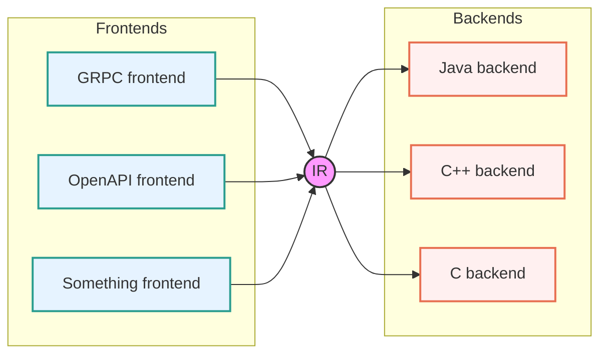

# Концепция

svarg преобразует поданные на входе языки описания спецификаций в svarg IR файлы (OpenAPI лишь пример такого языка)

затем svarg IR преобразуется в нужный язык программирования (например С++)

Это классическая идея компиляторов применённая к языкам спецификаций

## svarg IR

svarg IR не зависит от языка описания API и гораздо проще openapi описания - без сложных ссылок, схем, неоднозначностей и костылей, так что работать с ним и генерировать из него код легче

Над svarg IR проводятся оптимизации и преобразования для упрощения итогового кода. Получить и поиграться с оптимизациями можно запуская svarg-ir (билдится вместе с svarg). svarg-ir --help даст всю необходимую информацию

## Создание фронтенда

Для создания своего фронтенда достаточно написать программу, которая выдаёт из вашего языка svarg IR файлы. Готовым примером является [frontend/openapi](../include/svarg/frontend/)

## Создание бекенда

Бекенд принимает на вход IR файлы и отдаёт код конечного языка. Готовые примеры: [backend/cxx](../include/svarg/backend/cxx) и [jinja_backend](../jinja_backend/). jinja_backend содержит в себе перенесённый на Python код для парсинга и сериализации svarg IR и сам по себе не генерирует ни в какой язык, а лишь предоставляет возможность определить свои jinja шаблоны и "по быстрому" сделать backend

## Создание оптимизации svarg IR

Оптимизация это просто svarg IR -> <...> -> svarg IR. Встроенные в svarg оптимизации можно посмотреть в [svarg/ir/optimization_passes.hpp](../include/svarg/ir/optimization_passes.hpp)
